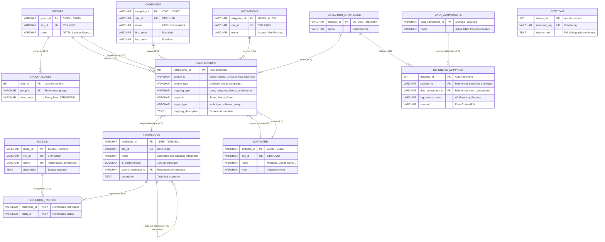

# CyberTrace: Entity-Relationship (ER) Diagram
## Level: Second-Year Undergraduate DBMS Project
**Directory**: `/diagrams/`  
**Tool**: Mermaid ER Specification + MySQL Workbench EER Model Instructions  

---

## 1. Visual Conceptual ER Diagram (Crow's Foot Notation)

---

## 2. Cardinality & Relationship Explanations

1. **`tactics` to `technique_tactics` to `techniques` ($M:N$)**:
   - One tactic associates with many techniques ($1:N$).
   - One technique belongs to one or more tactics ($1:N$).
   - Resolved using composite associative entity `technique_tactics`.
2. **`techniques` to `techniques` ($1:M$ Recursive)**:
   - A top-level technique has zero, one, or many sub-techniques.
   - A sub-technique has exactly one parent technique (`parent_technique_id`).
3. **`groups` to `group_aliases` ($1:M$)**:
   - One threat group has zero, one, or multiple alias names.
   - Each alias belongs to exactly one threat group.
4. **Universal M:N Associative Graph via `relationships`**:
   - Captures the 20,628 threat intelligence edges connecting Software, Groups, Campaigns, Mitigations, and Detection Strategies to Techniques without creating 8 separate redundant tables.

---

## 3. How to Open and View in MySQL Workbench

To generate the visual EER diagram in MySQL Workbench:
1. Open **MySQL Workbench**.
2. Connect to the local MySQL instance (`localhost:3306`).
3. Execute the database creation and table creation scripts (`01_create_database.sql` and `02_create_tables.sql`).
4. In the MySQL Workbench top menu, navigate to:  
   `Database` $\longrightarrow$ `Reverse Engineer...`
5. Select the `cybertrace` database.
6. Click **Next** through the wizard steps and click **Finish**.
7. MySQL Workbench will automatically lay out the visual EER Diagram displaying all tables, primary keys, foreign key connectors, and cardinalities!
