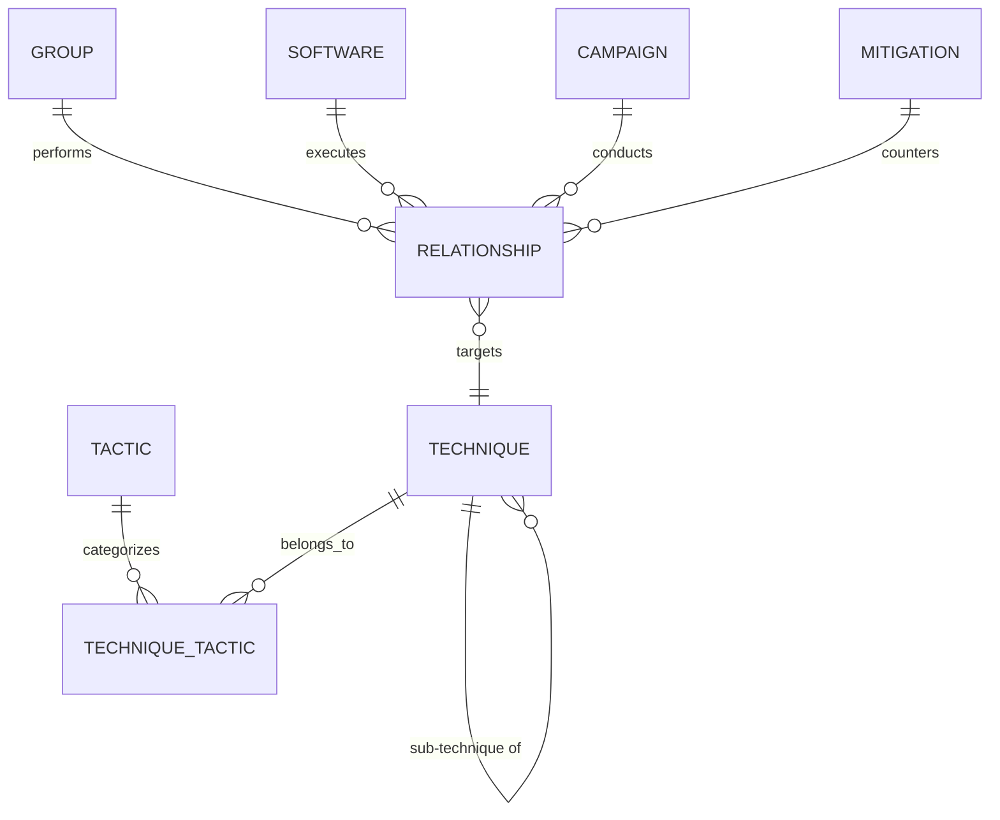

# CyberTrace: Cyber Threat Intelligence and Incident Correlation Platform
## Phase 1 – Database Engineering: MITRE ATT&CK Dataset Analysis
**Document**: `DATABASE_ANALYSIS.md`  
**Level**: Second-Year Undergraduate DBMS Academic Project  
**Author**: CyberTrace Project Team  
**Primary Dataset**: MITRE ATT&CK Enterprise Matrix v19.2 (`enterprise-attack-v19.2 (1).xlsx`)  
**Cleaned Working Copy**: `dataset/enterprise-attack-v19.2_cleaned.xlsx`  

---

## 1. Executive Summary & Purpose

The objective of **CyberTrace** is to model, normalize, store, validate, and analyze cyber threat intelligence (CTI) from the official MITRE ATT&CK Enterprise matrix within a relational DBMS (MySQL Server).

The MITRE ATT&CK framework provides an evidence-based knowledge base of adversary tactics, techniques, software, campaigns, and threat groups. However, the raw Excel distribution is organized primarily for human reading, spreadsheet navigation, and flat-file export. It contains multi-valued attributes, denormalized redundant names, repeating columns, and unconstrained cross-references.

This document presents a rigorous, sheet-by-sheet relational analysis of the complete workbook. Per academic DBMS guidelines, we evaluate every sheet to determine:
- Whether it represents a **Strong Entity**, **Weak Entity**, **M:N Associative Relationship**, or a **Visual Presentation Matrix**.
- Candidate Primary Keys, candidate Foreign Keys, and candidate keys.
- Normalization violations (1NF multi-valued attributes, 2NF partial dependencies, 3NF transitive redundancies).
- Handling of missing/NULL values and preservation of official MITRE identifiers (`Txxxx`, `TAxxxx`, `Sxxxx`, `Gxxxx`, `Cxxxx`, `Mxxxx`, `DCxxxx`, `ANxxxx`, `DETxxxx`).

---

## 2. Workbook Overview and Preservation Status

### 2.1 File Integrity & Protection
- **Source of Truth (Immutable)**: `enterprise-attack-v19.2 (1).xlsx` (Size: 5,183,062 bytes, ~5.18 MB). Preserved in read-only condition.
- **Working Preprocessing Copy**: `dataset/enterprise-attack-v19.2_cleaned.xlsx`. All data inspection, cleaning, filtering, and preparation are performed exclusively on this copy.
- **Total Sheets in Workbook**: 13 sheets.

### 2.2 Global Workbook Inventory Summary

| # | Sheet Name | Data Rows | Total Columns | Candidate PK | Relational Classification | Recommended Action |
|---|---|---|---|---|---|---|
| 1 | `techniques` | 697 | 17 | `ID` (`Txxxx`) | Strong / Recursive Entity | Primary Table (Decompose multi-valued columns) |
| 2 | `tactics` | 15 | 9 | `ID` (`TAxxxx`) | Strong Entity | Primary Table |
| 3 | `software` | 825 | 14 | `ID` (`Sxxxx`) | Strong Entity | Primary Table (Normalize platforms/aliases) |
| 4 | `groups` | 176 | 13 | `ID` (`Gxxxx`) | Strong Entity | Primary Table (Normalize aliases) |
| 5 | `campaigns` | 56 | 17 | `ID` (`Cxxxx`) | Strong Entity | Primary Table |
| 6 | `mitigations` | 44 | 10 | `ID` (`Mxxxx`) | Strong Entity | Primary Table |
| 7 | `Enterprise ATT&CK matrix` | 132 | 30 | None | Presentation Pivot Grid | **Do Not Convert to Table** (Represented via `technique_tactics`) |
| 8 | `relationships` | 20,628 | 13 | STIX ID / Auto-ID | Universal M:N Mapping Catalog | Decompose into typed junction tables / core mapping table |
| 9 | `datacomponents` | 106 | 9 | `ID` (`DCxxxx`) | Strong Entity | Primary Table |
| 10 | `analytics` | 1,758 | 9 | `ID` (`ANxxxx`) | Strong Entity | Primary Table |
| 11 | `detectionstrategies` | 697 | 9 | `ID` (`DETxxxx`) | Strong Entity | Primary Table |
| 12 | `defensive mappings` | 4,160 | 11 | Composite / Auto-ID | Multi-way Associative Entity | Normalize; eliminate transitive attribute redundancies |
| 13 | `citations` | 4,305 | 3 | Composite / Reference | Supporting Reference Entity | Primary / Reference Table |

---

## 3. Comprehensive Sheet-by-Sheet Relational Analysis

### 3.1 Sheet 1: `techniques`

- **Row Count**: 698 total rows (1 header row, 697 data rows).
- **Column Count**: 17 columns.
- **Column List**:
  1. `ID` (e.g., `T1548`, `T1548.002`)
  2. `STIX ID` (e.g., `attack-pattern--67720091-eee3-4d2d-ae16-8264567f6f5b`)
  3. `name` (e.g., `Abuse Elevation Control Mechanism`)
  4. `description` (Detailed text)
  5. `url` (e.g., `https://attack.mitre.org/techniques/T1548`)
  6. `created` (Date text, e.g., `30 January 2020`)
  7. `last modified` (Date text, e.g., `12 May 2026`)
  8. `domain` (String: `enterprise-attack`)
  9. `version` (e.g., `2.0`, `3.0`)
  10. `tactics` (Multi-valued comma-separated string, e.g., `Privilege Escalation, Defense Evasion`)
  11. `platforms` (Multi-valued comma-separated string, e.g., `Linux, macOS, Windows, Office Suite`)
  12. `is sub-technique` (Binary integer flag: `0` or `1`)
  13. `sub-technique of` (Parent Technique ID, e.g., `T1548`, or blank if top-level)
  14. `contributors` (Multi-valued semicolon/comma-separated names)
  15. `supports remote` (Boolean/text indicator where applicable)
  16. `impact type` (Text indicator)
  17. `relationship citations` (Citation references string)

- **Candidate Keys**:
  - `ID`: 697 unique values, 0 NULLs, 0 duplicates. **Selected Primary Key**.
  - `STIX ID`: 697 unique values, 0 NULLs, 0 duplicates. Alternate Candidate Key (`UNIQUE`).

- **Candidate Foreign Keys**:
  - `sub-technique of` -> Recursive Foreign Key referencing `techniques(ID)` (`ON DELETE RESTRICT/SET NULL`).

- **Relational Classification**: **Strong Entity with Recursive Self-Relationship**.
  - Top-level techniques have `is sub-technique = 0` and `sub-technique of IS NULL`.
  - Sub-techniques have `is sub-technique = 1` and `sub-technique of = <Parent ID>`.

- **Normalization Problems Discovered**:
  1. **1NF Violation (Multi-Valued `tactics`)**: A single technique frequently belongs to multiple tactics (e.g., *Privilege Escalation* and *Defense Evasion*). Storing multiple tactic names in one cell violates first normal form.
     - *Resolution*: Requires a dedicated junction table `technique_tactics(technique_id, tactic_id)`.
  2. **1NF Violation (Multi-Valued `platforms`)**: A technique can target multiple operating systems/platforms (Windows, Linux, macOS, Cloud, Network).
  3. **Redundancy/Transitive Dependency**: The sheet contains tactic names rather than tactic IDs, causing transitive dependencies on tactic naming changes.

---

### 3.2 Sheet 2: `tactics`

- **Row Count**: 16 total rows (1 header row, 15 data rows).
- **Column Count**: 9 columns.
- **Column List**:
  1. `ID` (e.g., `TA0001` - `TA0043`)
  2. `STIX ID` (e.g., `x-mitre-tactic--d108ce10-2419-4cf9-a774-46161d6c6cfe`)
  3. `name` (e.g., `Initial Access`, `Execution`, `Persistence`, `Privilege Escalation`, `Defense Evasion`, `Credential Access`, `Discovery`, `Lateral Movement`, `Collection`, `Command and Control`, `Exfiltration`, `Impact`, `Resource Development`, `Reconnaissance`)
  4. `description` (Detailed explanation of adversary goal)
  5. `url` (e.g., `https://attack.mitre.org/tactics/TA0001`)
  6. `created` (Date text)
  7. `last modified` (Date text)
  8. `domain` (String: `enterprise-attack`)
  9. `version` (Version string, e.g., `1.0`, `1.1`)

- **Candidate Keys**:
  - `ID`: 15 unique values, 0 NULLs, 0 duplicates. **Selected Primary Key**.
  - `STIX ID`: 15 unique values, 0 NULLs, 0 duplicates. Alternate Candidate Key (`UNIQUE`).
  - `name`: 15 unique values, 0 NULLs. Candidate Key (`UNIQUE`).

- **Candidate Foreign Keys**: None (Root entity in the cyber attack kill chain).

- **Relational Classification**: **Strong Entity**.

- **Normalization Status**: Already in **3NF / BCNF**. Every non-key attribute is non-transitively and fully functionally dependent on `ID`.

---

### 3.3 Sheet 3: `software`

- **Row Count**: 826 total rows (1 header row, 825 data rows).
- **Column Count**: 14 columns.
- **Column List**:
  1. `ID` (e.g., `S0001` - `S1185`)
  2. `STIX ID` (e.g., `malware--7bec698a...` or `tool--...`)
  3. `name` (Software title, e.g., `Mimikatz`, `Cobalt Strike`, `3PARA RAT`)
  4. `description` (Detailed technical overview)
  5. `url` (e.g., `https://attack.mitre.org/software/S0066`)
  6. `created` (Date text)
  7. `last modified` (Date text)
  8. `domain` (String: `enterprise-attack`)
  9. `version` (Version string)
  10. `contributors` (Multi-valued author/researcher text)
  11. `platforms` (Multi-valued comma-separated platforms)
  12. `aliases` (Multi-valued comma-separated tool aliases)
  13. `type` (Categorical string: `malware` or `tool`)
  14. `relationship citations` (Citations text)

- **Candidate Keys**:
  - `ID`: 825 unique values, 0 NULLs, 0 duplicates. **Selected Primary Key**.
  - `STIX ID`: 825 unique values, 0 NULLs, 0 duplicates. Alternate Candidate Key (`UNIQUE`).

- **Candidate Foreign Keys**: None within the sheet.

- **Relational Classification**: **Strong Entity**.

- **Normalization Problems Discovered**:
  1. **1NF Violation**: `platforms` and `aliases` contain repeating comma-separated values.
  2. Categorical `type` has domain `{malware, tool}`, which should be enforced using a MySQL `CHECK (type IN ('malware', 'tool'))` or `VARCHAR(20)`.

---

### 3.4 Sheet 4: `groups`

- **Row Count**: 177 total rows (1 header row, 176 data rows).
- **Column Count**: 13 columns.
- **Column List**:
  1. `ID` (e.g., `G0001` - `G1049`)
  2. `STIX ID` (e.g., `intrusion-set--8332952e-b86b-486b-acc3-1c2a85d39394`)
  3. `name` (Primary threat group name, e.g., `APT28`, `Lazarus Group`, `Sandworm Team`)
  4. `description` (Threat actor origin, targets, history)
  5. `url` (e.g., `https://attack.mitre.org/groups/G0099`)
  6. `created` (Date text)
  7. `last modified` (Date text)
  8. `domain` (Domain string)
  9. `version` (Version string)
  10. `contributors` (Research contributors)
  11. `associated groups` (Multi-valued aliases, e.g., `Fancy Bear, Sednit, Sofacy, STRONTIUM`)
  12. `associated groups citations`
  13. `relationship citations`

- **Candidate Keys**:
  - `ID`: 176 unique values, 0 NULLs, 0 duplicates. **Selected Primary Key**.
  - `STIX ID`: 176 unique values, 0 NULLs, 0 duplicates. Alternate Candidate Key (`UNIQUE`).

- **Relational Classification**: **Strong Entity**.

- **Normalization Problems Discovered**:
  1. **1NF Violation**: `associated groups` contains multi-valued aliases in a single cell. Storing aliases directly in the main table creates search inefficiencies and violates atomicity.

---

### 3.5 Sheet 5: `campaigns`

- **Row Count**: 57 total rows (1 header row, 56 data rows).
- **Column Count**: 17 columns.
- **Column List**:
  1. `ID` (e.g., `C0001` - `C0057`)
  2. `STIX ID` (e.g., `campaign--46421788-b6e1-4256-b351-f8beffd1afba`)
  3. `name` (e.g., `2015 Ukraine Electric Power Attack`, `SolarWinds Compromise`)
  4. `description` (Detailed campaign narrative)
  5. `url` (e.g., `https://attack.mitre.org/campaigns/C0028`)
  6. `created` (Date text)
  7. `last modified` (Date text)
  8. `domain` (e.g., `enterprise-attack,ics-attack`)
  9. `version` (Version string)
  10. `associated campaigns` (Aliases / related campaign identifiers)
  11. `associated campaigns citations`
  12. `first seen` (Date string representing campaign start)
  13. `first seen citation`
  14. `last seen` (Date string representing campaign conclusion)
  15. `last seen citation`
  16. `contributors`
  17. `relationship citations`

- **Candidate Keys**:
  - `ID`: 56 unique values, 0 NULLs, 0 duplicates. **Selected Primary Key**.
  - `STIX ID`: 56 unique values, 0 NULLs, 0 duplicates. Alternate Candidate Key (`UNIQUE`).

- **Relational Classification**: **Strong Entity**.

- **Temporal Attributes**: `first seen` and `last seen` provide timeline boundaries for adversary intrusion sets.

---

### 3.6 Sheet 6: `mitigations`

- **Row Count**: 45 total rows (1 header row, 44 data rows).
- **Column Count**: 10 columns.
- **Column List**:
  1. `ID` (e.g., `M1015` - `M1056`)
  2. `STIX ID` (e.g., `course-of-action--f9f9e6ef...`)
  3. `name` (e.g., `Account Use Policies`, `Active Directory Configuration`, `Multi-factor Authentication`)
  4. `description` (Prescribed preventive/corrective security measures)
  5. `url` (e.g., `https://attack.mitre.org/mitigations/M1036`)
  6. `created` (Date text)
  7. `last modified` (Date text)
  8. `domain` (String: `enterprise-attack`)
  9. `version` (Version string)
  10. `relationship citations`

- **Candidate Keys**:
  - `ID`: 44 unique values, 0 NULLs, 0 duplicates. **Selected Primary Key**.
  - `STIX ID`: 44 unique values, 0 NULLs, 0 duplicates. Alternate Candidate Key (`UNIQUE`).

- **Relational Classification**: **Strong Entity**.

---

### 3.7 Sheet 7: `Enterprise ATT&CK matrix`

- **Row Count**: 133 total rows (1 header row, 132 data rows).
- **Column Count**: 30 columns.
- **Structure & Layout**:
  - The headers consist of alternating tactic names and blank sub-headers: `Reconnaissance`, `<blank>`, `Resource Development`, `<blank>`, `Initial Access`, `<blank>`, `Execution`, `<blank>`, `Persistence`, `<blank>`, `Privilege Escalation`, `<blank>`, `Stealth`, `<blank>`, `Defense Impairment`, `<blank>`, `Credential Access`, `<blank>`, `Discovery`, `<blank>`, `Lateral Movement`, `<blank>`, `Collection`, `<blank>`, `Command and Control`, `<blank>`, `Exfiltration`, `<blank>`, `Impact`, `<blank>`.
  - Cells below each tactic header contain individual Technique names (e.g., `Active Scanning`, `Acquire Access`, `BITS Jobs`) and their sub-techniques.
- **Relational Assessment**:
  - **CRITICAL DESIGN FINDING**: This sheet is a visual spreadsheet layout created exclusively for human matrix browsing on screen.
  - It has no candidate primary key, contains empty columns, and represents a multi-column unpivoted cross-tabulation.
  - **Verdict**: **DO NOT convert this sheet into a MySQL table.**
  - The exact data contained here is fundamentally captured in the normalized relational model through the `technique_tactics` junction table and can be reconstructed at query time via SQL `JOIN` or `VIEW`.

---

### 3.8 Sheet 8: `relationships`

- **Row Count**: 20,629 total rows (1 header row, 20,628 data rows).
- **Column Count**: 13 columns.
- **Column List**:
  1. `source ID` (e.g., `S0066`, `G0034`, `C0028`, `M1036`, `DET0103`)
  2. `source name` (e.g., `3PARA RAT`, `Sandworm Team`, `2015 Ukraine Electric Power Attack`)
  3. `source ref` (STIX source URI/UUID)
  4. `source type` (Categorical: `software`, `group`, `mitigation`, `campaign`, `detectionstrategy`)
  5. `mapping type` (Categorical: `uses`, `mitigates`, `detects`, `attributed-to`)
  6. `target ID` (e.g., `T1548`, `S0066`, `G0034`)
  7. `target name` (e.g., `Abuse Elevation Control Mechanism`)
  8. `target ref` (STIX target URI/UUID)
  9. `target type` (Categorical: `technique`, `software`, `group`)
  10. `mapping description` (Detailed contextual note explaining how/why the entity uses or mitigates the target)
  11. `STIX ID` (Unique UUID, e.g., `relationship--4d407dda-944a-4974-b1c2-0a04d2c9ee4c`)
  12. `created` (Date text)
  13. `last modified` (Date text)

- **Comprehensive Cardinality & Mapping Distribution**:

| Source Type | Mapping Type | Target Type | Row Count | Semantic Meaning in Threat Intelligence |
|---|---|---|---|---|
| `software` | `uses` | `technique` | **11,362** | Specific malware or utility executes a technique |
| `group` | `uses` | `technique` | **4,628** | Adversary group observed employing a technique |
| `mitigation` | `mitigates` | `technique` | **1,448** | Security control prevents or reduces technique efficacy |
| `group` | `uses` | `software` | **1,149** | Adversary group observed operating software/tools |
| `campaign` | `uses` | `technique` | **1,146** | Specific time-bounded campaign utilized a technique |
| `detectionstrategy` | `detects` | `technique` | **697** | Detection strategy monitors and identifies a technique |
| `campaign` | `uses` | `software` | **172** | Campaign leveraged a specific tool or malware piece |
| `campaign` | `attributed-to` | `group` | **26** | Campaign definitively attributed to an intrusion set/group |
| **Total** | | | **20,628** | Complete MITRE Threat Graph |

- **Candidate Keys**:
  - `STIX ID`: 20,628 unique values, 0 NULLs, 0 duplicates. Alternate Candidate Key (`UNIQUE`).
  - Composite Candidate Key: `(source ID, target ID, mapping type)`.
  - Academic Best Practice: An auto-incrementing integer `relationship_id INT AUTO_INCREMENT PRIMARY KEY` for clean indexing and high-performance foreign key references.

- **Normalization Problems Discovered**:
  1. **Transitive & Redundant Dependencies (2NF/3NF Violations)**:
     - `source name` depends on `source ID` (defined in the respective entity sheet).
     - `target name` depends on `target ID` (defined in the respective entity sheet).
     - Storing both IDs and names creates massive redundancy (repeating names thousands of times). If a technique name updates, thousands of relationship rows become inconsistent.
     - *Resolution*: In normalized schema, retain `source_id`, `target_id`, `mapping_type`, `mapping_description`, and omit redundant name strings.

---

### 3.9 Sheet 9: `datacomponents`

- **Row Count**: 107 total rows (1 header row, 106 data rows).
- **Column Count**: 9 columns.
- **Column List**:
  1. `ID` (e.g., `DC0001` - `DC0103`)
  2. `STIX ID` (e.g., `x-mitre-data-component--2e521444...`)
  3. `name` (e.g., `Active DNS`, `Process Creation`, `Command Execution`, `Network Traffic Flow`)
  4. `description` (Detailed telemetry specifications and collection guidance)
  5. `url` (e.g., `https://attack.mitre.org/datacomponents/DC0103`)
  6. `created`
  7. `last modified`
  8. `domain`
  9. `version`

- **Candidate Keys**:
  - `ID`: 106 unique values, 0 NULLs, 0 duplicates. **Selected Primary Key**.
  - `STIX ID`: 106 unique values, 0 NULLs, 0 duplicates. Alternate Candidate Key (`UNIQUE`).

- **Relational Classification**: **Strong Entity** representing detection telemetry data sources.

---

### 3.10 Sheet 10: `analytics`

- **Row Count**: 1,759 total rows (1 header row, 1,758 data rows).
- **Column Count**: 9 columns.
- **Column List**:
  1. `ID` (e.g., `AN0001` - `AN1758`)
  2. `STIX ID` (e.g., `x-mitre-analytic--5d47e6b2...`)
  3. `name` (Specific analytic query title)
  4. `description` (Logic description)
  5. `url`
  6. `created`
  7. `last modified`
  8. `domain`
  9. `version`

- **Candidate Keys**:
  - `ID`: 1,758 unique values, 0 NULLs, 0 duplicates. **Selected Primary Key**.
  - `STIX ID`: 1,758 unique values, 0 NULLs, 0 duplicates. Alternate Candidate Key (`UNIQUE`).

- **Relational Classification**: **Strong Entity** representing analytical algorithms/rules.

---

### 3.11 Sheet 11: `detectionstrategies`

- **Row Count**: 698 total rows (1 header row, 697 data rows).
- **Column Count**: 9 columns.
- **Column List**:
  1. `ID` (e.g., `DET0001` - `DET0697`)
  2. `STIX ID` (e.g., `x-mitre-detection-strategy--00060b87...`)
  3. `name` (e.g., `Behavioral Detection of Network Share Connection Removal via CLI`)
  4. `url`
  5. `created`
  6. `last modified`
  7. `domain`
  8. `version`
  9. `analytic_refs` (References to analytic UUIDs)

- **Candidate Keys**:
  - `ID`: 697 unique values, 0 NULLs, 0 duplicates. **Selected Primary Key**.
  - `STIX ID`: 697 unique values, 0 NULLs. Candidate Key (`UNIQUE`).

- **Relational Classification**: **Strong Entity**.

---

### 3.12 Sheet 12: `defensive mappings`

- **Row Count**: 4,161 total rows (1 header row, 4,160 data rows).
- **Column Count**: 11 columns.
- **Column List**:
  1. `detection_strategy_attack_id` (e.g., `DET0103`)
  2. `detection_strategy_id` (STIX UUID)
  3. `detection_strategy_name` (Text name)
  4. `analytic_id` (STIX UUID)
  5. `analytic_name` (e.g., `AN0286`)
  6. `platforms` (e.g., `Windows`, `Linux`)
  7. `log_source_name` (e.g., `WinEventLog:Security`, `WinEventLog:Sysmon`)
  8. `channel` (e.g., `EventCode=4624, 4648`)
  9. `data_component_id` (STIX UUID)
  10. `data_component_name` (e.g., `Logon Session Creation`, `Process Creation`)
  11. `data_component_attack_id` (e.g., `DC0067`, `DC0032`)

- **Candidate Keys**:
  - No single column is unique (`detection_strategy_attack_id` has 652 unique values across 4,160 rows).
  - Composite Key: `(detection_strategy_attack_id, analytic_id, data_component_attack_id, log_source_name)`.
  - Alternatively: Surrogate primary key `defensive_mapping_id INT AUTO_INCREMENT PRIMARY KEY`.

- **Relational Classification**: **Multi-Way Associative Relationship**.

- **Severe Normalization Violations (2NF / 3NF)**:
  - Redundant Strategy Names: `detection_strategy_name` is transitively dependent on `detection_strategy_attack_id`.
  - Redundant Data Component Names: `data_component_name` is transitively dependent on `data_component_attack_id`.
  - Redundant Analytic Names: `analytic_name` is transitively dependent on `analytic_id`.
  - *Resolution*: Decomposition into foreign keys referencing `detectionstrategies`, `analytics`, and `datacomponents`.

---

### 3.13 Sheet 13: `citations`

- **Row Count**: 4,306 total rows (1 header row, 4,305 data rows).
- **Column Count**: 3 columns.
- **Column List**:
  1. `reference` (Citation key tag, e.g., `(Citation: Mandiant APT1)`)
  2. `citation` (Full bibliographic text citation, author, publication, date)
  3. `url` (Direct external URL link to source material)

- **Candidate Keys**:
  - `reference`: Unique citation tag identifier.
  - Surrogate Key: `citation_id INT AUTO_INCREMENT PRIMARY KEY`.

- **Relational Classification**: **Supporting Reference Entity**.

---

## 4. Synthesis: Entities, Attributes, and Relationships

### 4.1 Master Entity Catalog

1. **Tactics (`tactics`)**: High-level adversarial objectives (15 records).
2. **Techniques (`techniques`)**: Concrete actions taken by adversaries (697 records, with recursive sub-techniques).
3. **Software (`software`)**: Malware and legitimate administrative tools utilized (825 records).
4. **Groups (`groups`)**: Known threat actors, nation-state groups, cybercrime syndicates (176 records).
5. **Campaigns (`campaigns`)**: Time-bounded threat activities and targeted operations (56 records).
6. **Mitigations (`mitigations`)**: Security controls, configuration changes, architectural defensive measures (44 records).
7. **Data Components (`data_components`)**: Telemetry logs and security audit points (106 records).
8. **Detection Strategies & Analytics (`detection_strategies`, `analytics`)**: Threat detection logic and engineering rules.

### 4.2 Identified Core Relationships

1. **Technique ↔ Tactic (Many-to-Many M:N)**:
   - *Nature*: A technique can achieve multiple tactical objectives (e.g., credential access AND privilege escalation). A tactic contains dozens of techniques.
   - *Implementation*: Associative junction table `technique_tactics(technique_id, tactic_id)`.
2. **Technique ↔ Parent Technique (Recursive 1:Many 1:M)**:
   - *Nature*: Sub-techniques belong to exactly one parent technique.
   - *Implementation*: Foreign key `sub_technique_of` in `techniques` referencing `techniques(id)`.
3. **Software ↔ Technique (Many-to-Many M:N)**:
   - *Evidence*: 11,362 rows in `relationships` (`software` -> `uses` -> `technique`).
4. **Group ↔ Technique (Many-to-Many M:N)**:
   - *Evidence*: 4,628 rows in `relationships` (`group` -> `uses` -> `technique`).
5. **Mitigation ↔ Technique (Many-to-Many M:N)**:
   - *Evidence*: 1,448 rows in `relationships` (`mitigation` -> `mitigates` -> `technique`).
6. **Group ↔ Software (Many-to-Many M:N)**:
   - *Evidence*: 1,149 rows in `relationships` (`group` -> `uses` -> `software`).
7. **Campaign ↔ Technique (Many-to-Many M:N)**:
   - *Evidence*: 1,146 rows in `relationships` (`campaign` -> `uses` -> `technique`).
8. **Campaign ↔ Group (Many-to-One M:1 / Attribution)**:
   - *Evidence*: 26 rows in `relationships` (`campaign` -> `attributed-to` -> `group`).

---

## 5. Normalization Issues & Decomposition Strategy

| Normal Form | Raw Excel Issue | Specific Workbook Columns | Academic Relational Solution |
|---|---|---|---|
| **1NF** (Atomicity) | Multi-valued cells | `techniques.tactics`, `techniques.platforms`, `software.platforms`, `groups.associated groups` | Split into atomic rows or relational junction tables (`technique_tactics`, `technique_platforms`). |
| **2NF** (Partial Dependency) | Composite key tables storing dependent attributes | `defensive mappings` storing strategy name and data component name alongside composite keys | Isolate non-key descriptive attributes into respective entity tables; retain only foreign keys in mapping table. |
| **3NF** (Transitive Dependency) | Non-key attributes determining other non-key attributes | `relationships.source name` determined by `source ID`; `relationships.target name` determined by `target ID` | Remove redundant names from `relationships`; use SQL `INNER JOIN` against entity tables to resolve names dynamically. |
| **Pivot Grid Violation** | Multi-column spreadsheet matrix | `Enterprise ATT&CK matrix` sheet (30 columns) | Discard as a physical table. Reconstruct dynamically via views and queries joining `tactics` and `techniques`. |

---

## 6. Preprocessing Requirements for Excel Working Copy

In Step 2, Microsoft Excel will be used on `dataset/enterprise-attack-v19.2_cleaned.xlsx` to carry out the following verified preprocessing tasks:
1. **Preserve Identifiers**: Ensure `ID` fields (`Txxxx`, `TAxxxx`, `Sxxxx`, `Gxxxx`, etc.) remain in their original string formats without scientific notation or leading-zero truncation.
2. **Handle Multi-Valued Attributes**: Extract `techniques.tactics` mapping pairs for population of the `technique_tactics` junction table.
3. **Whitespace Trimming**: Standardize leading/trailing whitespace across textual columns using `=TRIM()`.
4. **Line-Break & Quote Sanitation**: Sanitize multiline description cells to ensure clean tabular export to CSV UTF-8.
5. **Legitimate NULLs**: Verify that NULL values (such as `sub-technique of` for top-level techniques or `first seen` for ongoing campaigns) are retained as legitimate database `NULL`s and not fabricated.

---

## 7. Conclusion & Ready for Review

The MITRE ATT&CK Enterprise workbook provides an authoritative, complete, and rich foundation for CyberTrace. Every sheet has been inspected and relatonally classified without deleting meaningful data or inventing relationships. 

The next phase is **Step 2 & 3: Excel Data Preprocessing & Preprocessing Report (`DATA_PREPROCESSING_REPORT.md`)**.
