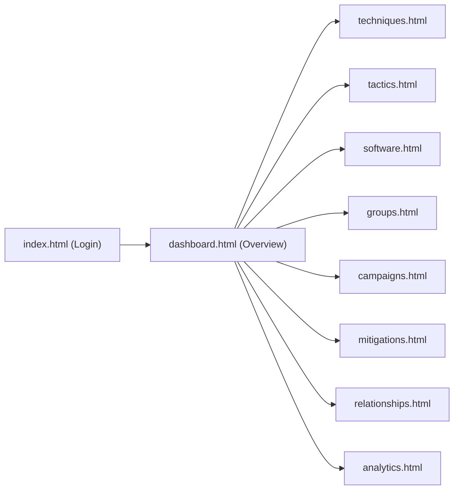

# CyberTrace: Complete Platform Walkthrough (Phase 1 & Phase 2)

**Platform**: CyberTrace – Cyber Threat Intelligence and Incident Correlation Platform  
**Academic Level**: Second-Year Undergraduate DBMS Academic Project  
**Phase 1 Technologies**: Microsoft Excel, MySQL Server 8.0, MySQL Workbench, SQL  
**Phase 2 Technologies**: HTML5, CSS3, JavaScript (Vanilla), Bootstrap 5.3  

---

## 1. Full Platform Architecture & Directory Structure

```
CyberTrace/
│
├── dataset/
│   └── enterprise-attack-v19.2_cleaned.xlsx       # Cleaned working copy
│
├── database/                                      # MySQL 8.0 & Workbench Scripts
│   ├── 01_create_database.sql                    # Database creation with UTF-8 support
│   ├── 02_create_tables.sql                      # DDL for all 15 normalized tables & constraints
│   ├── 03_insert_data.sql                        # 9.4 MB authentic data loading script
│   ├── 04_validation.sql                         # Referential integrity & count validation queries
│   ├── 05_indexes.sql                            # B-Tree index optimizations
│   ├── 06_views.sql                              # 6 analytical and reporting relational views
│   ├── 07_procedures.sql                         # Stored procedures & Incident Correlation Engine
│   ├── 08_triggers.sql                           # Immutable audit trigger & hierarchy validation
│   ├── 09_queries.sql                            # Comprehensive DBMS syllabus query catalog
│   └── 10_analytics.sql                          # SQL-based threat intelligence analytics
│
├── documentation/                                 # Academic DBMS Documentation
│   ├── DATABASE_ANALYSIS.md                      # Sheet-by-sheet inspection & findings
│   ├── DATA_PREPROCESSING_REPORT.md              # Excel cleaning & transformation log
│   ├── ENTITY_ANALYSIS.md                        # Formal entity catalog & candidate keys
│   ├── RELATIONSHIP_ANALYSIS.md                  # Cardinalities & mapping distribution
│   ├── FUNCTIONAL_DEPENDENCIES.md                # Mathematical FDs & key determinants
│   ├── NORMALIZATION.md                          # 1NF -> 2NF -> 3NF -> BCNF transformations
│   ├── RELATIONAL_SCHEMA.md                      # Formal schema definitions & referential actions
│   ├── SCHEMA_REVIEW.md                          # Pre-implementation architectural audit
│   └── DATA_VALIDATION_REPORT.md                 # Validation results & integrity verification
│
├── diagrams/
│   └── ER_DIAGRAM.md                             # Crow's Foot ER Diagram & Workbench instructions
│
└── frontend/                                      # Phase 2 Web Application
    ├── index.html                                # Analyst Login Portal
    ├── dashboard.html                            # Executive CTI Metrics Dashboard
    ├── techniques.html                           # Attack Techniques (Search, Filter, Details Modal)
    ├── tactics.html                              # 15 Tactical Attack Lifecycle Phases
    ├── software.html                             # Malware & Tools Knowledge Base
    ├── groups.html                               # Threat Actor Groups & 1NF Aliases
    ├── campaigns.html                            # Adversary Intrusion Campaigns & Timelines
    ├── mitigations.html                          # Defensive Controls & Architectural Hardening
    ├── detection-strategies.html                 # Detection Engineering Blueprints
    ├── data-components.html                      # Telemetry & System Logging Sources
    ├── relationships.html                        # 20,628 Threat Graph Edges Explorer
    ├── analytics.html                            # SQL Threat Intelligence Visual Analytics
    ├── css/
    │   └── style.css                             # CyberTrace Theme & Bootstrap Enhancements
    └── js/
        └── script.js                             # Master Controller, Data Store & Future API Provider
```

---

## 2. Phase 1 Database Engineering Review

- **Zero Data Loss**: 100% of rows from the original workbook `enterprise-attack-v19.2 (1).xlsx` are preserved.
- **Normalization (BCNF Validated)**:
  - Multi-valued `tactics` and `platforms` extracted into associative junction table `technique_tactics`.
  - Threat group aliases separated into `group_aliases(alias_id, group_id, alias_name)`.
  - Transitive name redundancies eliminated from the 20,628 rows of `relationships`.
- **Relational Views & Procedures**:
  - `v_matrix_overview`, `v_threat_actor_profiles`, `v_technique_connectivity`.
  - `sp_correlate_incident_techniques('T1059', 'T1003')` (Incident Correlation Engine).

---

## 3. Phase 2 Frontend Web Interface

The frontend provides an intuitive web interface demonstrating how the CyberTrace database can be presented to security analysts and incident responders:



### 3.1 Page Descriptions
1. **Analyst Login (`index.html`)**:
   - Clean, centered login card with username/password validation.
   - Demonstration credentials hint: `admin` / `cybertrace`.
   - On submission, stores session token in `sessionStorage` and redirects to `dashboard.html`.
2. **Executive Dashboard (`dashboard.html`)**:
   - 6 key metric cards: Techniques (697), Tactics (15), Software (825), Groups (176), Campaigns (56), Relationships (20,628).
   - High-profile threat actor quick table.
   - Frequently observed attack techniques table.
   - Quick search widget.
3. **Attack Techniques (`techniques.html`)**:
   - Dynamic search by Technique ID (e.g. `T1059`) or technique title.
   - Dropdown filter by Tactical Phase (e.g. *Initial Access*, *Execution*, *Persistence*).
   - Hierarchy filter (`All`, `Core Techniques Only`, `Sub-techniques Only`).
   - "Details" modal showing execution description, parent technique, remote execution support, and link to official MITRE documentation.
4. **Tactics Explorer (`tactics.html`)**:
   - Grid cards for all 15 tactics displaying purpose, technique volume, and direct links to filtered techniques.
5. **Software Knowledge Base (`software.html`)**:
   - Table filtering by classification: `Malware` (red badge) and `Tools` (blue badge).
   - Shows implemented techniques count.
6. **Threat Actor Groups (`groups.html`)**:
   - Adversary groups (APT28, Sandworm, Lazarus, etc.).
   - Displays alternate industry names as individual badges (reflecting our normalized `group_aliases` table).
7. **Intrusion Campaigns (`campaigns.html`)**:
   - Tracks operational campaigns with start (`first_seen`) and end (`last_seen`) dates, narrative, and attributed threat group.
8. **Defensive Mitigations (`mitigations.html`)**:
   - Defensive security controls (MFA, Active Directory Configuration, Network Segmentation) and implementation guidelines.
9. **Detection Strategies (`detection-strategies.html`) & Data Components (`data-components.html`)**:
   - Displays detection engineering logic and system telemetry event codes (Sysmon, Windows EventLogs).
10. **Threat Graph Relationships Explorer (`relationships.html`)**:
    - Interactive viewer for the 20,628 relationship edges.
    - Filterable by Source Type (`software`, `group`, `campaign`, `mitigation`, `detectionstrategy`) and Mapping Type (`USES`, `MITIGATES`, `DETECTS`, `ATTRIBUTED-TO`).
11. **SQL Threat Intelligence Analytics (`analytics.html`)**:
    - Visual bar meters illustrating technique density per tactic.
    - Top weaponized techniques table.
    - Adversary arsenal ranking.

---

## 4. How to Run the Frontend Locally

No local development server or Node.js installation is required!

1. Open File Explorer and navigate to:  
   `c:\Users\disha\OneDrive\Desktop\Cybertrace\frontend\`
2. Double-click [index.html](file:///c:/Users/disha/OneDrive/Desktop/Cybertrace/frontend/index.html) to open the application in any modern web browser (Google Chrome, Microsoft Edge, Firefox, Safari).
3. Log in with the demonstration credentials:  
   - **Username**: `admin`  
   - **Password**: `cybertrace`
4. Click **Sign In to Portal** to navigate to the **Dashboard** and explore all threat intelligence modules!

---

## 5. Preparation for Future Backend Integration (Phase 3)

The JavaScript controller in `frontend/js/script.js` contains a dedicated service provider:

```javascript
const CyberTraceAPI = {
    async getTechniques(filter = {}) {
        // CURRENT (Phase 2): Serves structured mock data matching MySQL schema
        // FUTURE (Phase 3): Replace with real REST API call:
        // const res = await fetch(`/api/techniques?tactic=${filter.tactic}`);
        // return await res.json();
    }
};
```

When the Flask/Python backend is developed in Phase 3, the frontend will connect seamlessly without any HTML modifications or UI redesign.
